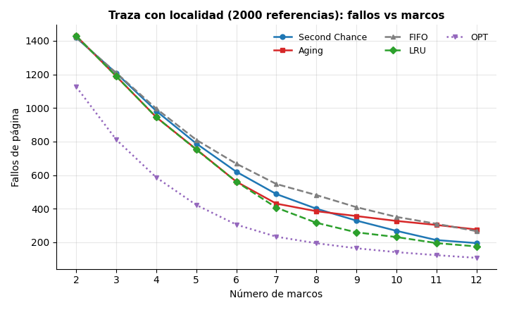
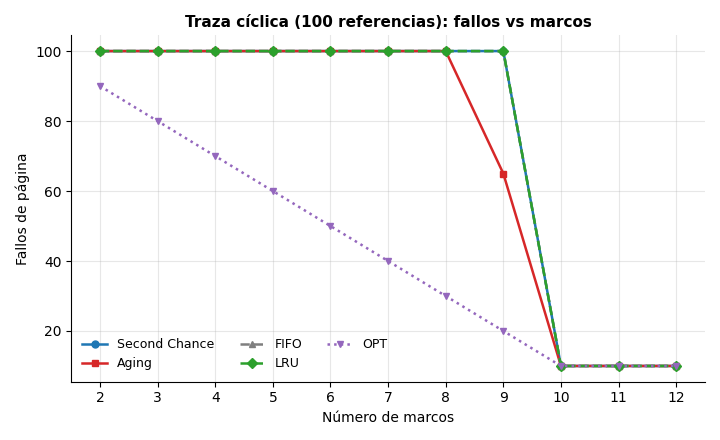
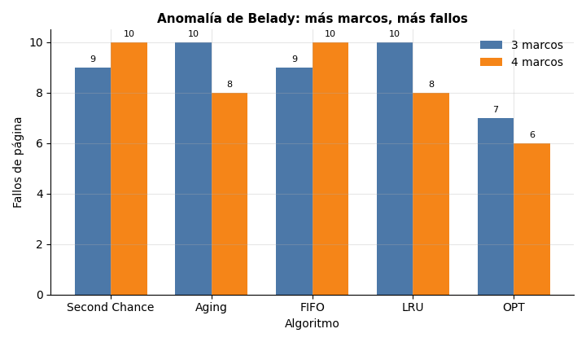
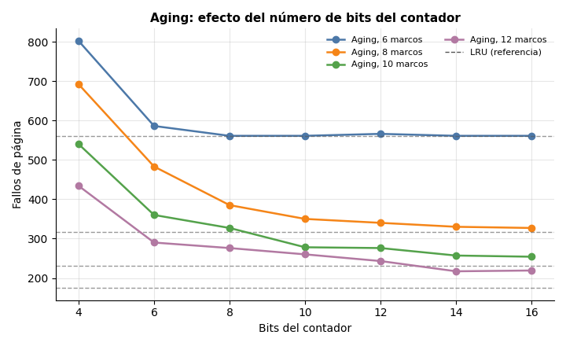
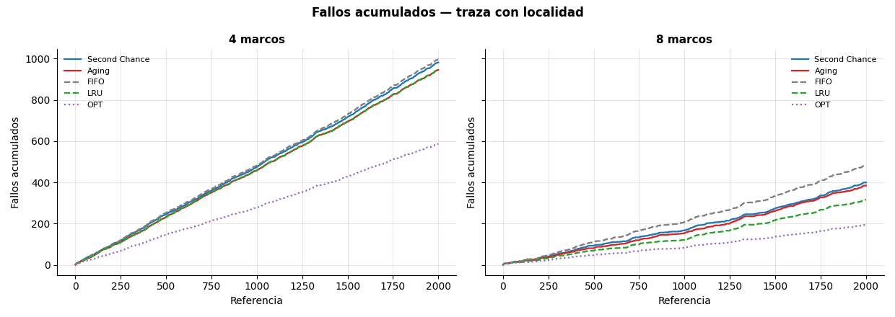

# Simulación de administración de memoria: Second Chance y Aging

**Tarea 5, Sistemas Operativos. Equipo E04**

Simulador en C de algoritmos de reemplazo de páginas. Los algoritmos
seleccionados por el equipo son **Second Chance (reloj)** y **Aging
(envejecimiento)**. FIFO, LRU y OPT se incluyen como líneas base de
comparación, no como parte de la selección.

## Resumen

Se implementó un simulador en C11 de reemplazo de páginas con Second Chance y
Aging, y se usaron FIFO, LRU y OPT como líneas base. Se probaron cinco cadenas
de referencia (clásica, Belady, cíclica y dos con localidad) midiendo fallos,
aciertos, expulsiones y costo. Con 4 marcos, Aging empató con LRU (945 fallos
en la traza de 2000 referencias) y redujo los fallos de Second Chance en
3.8 %; Second Chance requiere un solo bit de referencia por marco en el modelo
teórico. Con más marcos, el Aging de 8 bits perdió terreno frente a Second
Chance, y aumentar el contador a 14–16 bits recuperó buena parte de la
diferencia. Second Chance exhibió la anomalía de Belady; Aging no. La conclusión
es que no hay un ganador absoluto: el resultado depende de la localidad de la
carga, del tamaño de la memoria y del presupuesto de metadata.

---

## 1. Selección y puntaje

Equipo E04, de 2 integrantes (mínimo de complejidad: 4 puntos). Los algoritmos
seleccionados son **Second Chance** y **Aging**, registrados en la hoja
compartida.

| Campo | Valor |
|---|---|
| Equipo | E04 |
| Integrantes | David Rivera Morales (320176876) y Yessica Vianney Montes de Oca Aguilar (315050116) |
| Algoritmos seleccionados | Second Chance y Aging |
| Repositorio | <https://github.com/MxDui/sistemas-operativos/tree/main/tarea-5> |

Los dos algoritmos son complementarios: Second Chance usa **un solo bit** por
marco y es muy barato, mientras que Aging usa un **contador de N bits** por
marco y consigue una aproximación más fina a LRU. Compararlos permite discutir
el compromiso entre metadata, costo computacional y tasa de fallos.

> **Nota sobre el nombre "Aging".** En planificación de CPU, *aging* es el
> aumento gradual de prioridad para evitar inanición. En administración de
> memoria, *Aging* es el algoritmo de contadores de envejecimiento que aproxima
> LRU. Este trabajo usa la segunda acepción, que es la que corresponde a la
> tabla de algoritmos de reemplazo de páginas.

---

## 2. Marco teórico

La memoria virtual divide el espacio de direcciones de un proceso en
**páginas** y la memoria física en **marcos** del mismo tamaño. Cuando una
página no está en un marco se produce un **fallo de página**; el sistema
operativo debe traerla desde disco y, si no hay marcos libres, **expulsar**
alguna página residente.

El algoritmo de reemplazo decide cuál expulsar. La calidad se mide con la
**tasa de fallos** sobre una **cadena de referencias**:

```
fallos de página / número de referencias
```

Las referencias reales tienen **localidad**: un programa tiende a usar un
conjunto reducido de páginas durante un intervalo y luego cambia a otro. Por
eso los algoritmos que recuerdan qué páginas se usaron recientemente suelen
ganar. LRU (Least Recently Used) expulsa la página usada hace más tiempo, pero
mantener el orden exacto de uso es caro. Second Chance y Aging son dos
aproximaciones de bajo costo:

| Algoritmo | Metadata por marco | Idea | Aproxima a |
|---|---|---|---|
| Second Chance | 1 bit de referencia | Reloj circular con segunda oportunidad | LRU / FIFO híbrido |
| Aging | N bits (8 por defecto) | Contador que envejece y pesa las referencias recientes | LRU con historia finita |
| FIFO | 0 bits extra | Expulsa la página más antigua | - |
| LRU | Orden de uso | Expulsa la usada hace más tiempo | - (exacto) |
| OPT | Conocimiento del futuro | Expulsa la que tardará más en volver | - (óptimo teórico) |

Dos conceptos aparecen en el análisis:

- **Anomalía de Belady:** con FIFO, aumentar el número de marcos puede
  *aumentar* el número de fallos. Ocurre porque FIFO no es un algoritmo de
  pila (*stack algorithm*).
- **Propiedad de pila:** si un algoritmo la cumple, los fallos con `F` marcos
  son un superconjunto de los fallos con `F+1` marcos. LRU y OPT la cumplen;
  FIFO no. Second Chance tampoco la cumple (§6.3 muestra la anomalía); Aging
  no es de pila en sentido estricto, aunque en las trazas de este trabajo no
  mostró la anomalía.

---

## 3. Descripción de los algoritmos

### 3.1 Second Chance (reloj)

Se mantienen los marcos en una lista circular y un puntero `hand`. Cada marco
tiene un **bit de referencia R**:

- `R = 1` significa que la página se usó desde la última revisión del reloj.
- `R = 0` significa "no se usó recientemente; es candidata a salir".

En cada referencia:

1. Si la página está en memoria (**acierto**), se pone `R = 1`.
2. Si no está (**fallo**):
   - Se examina el marco apuntado por `hand`.
   - Si `R = 1`, se le da una **segunda oportunidad**: se limpia a `R = 0` y
     se avanza el puntero.
   - Si `R = 0`, ese marco es la víctima. Se carga la página nueva con `R = 1`
     y se avanza el puntero.
3. Si hay marcos libres, se usa uno de ellos y también se avanza el puntero.

Pseudocódigo:

```
si p está en memoria:
    R[p] = 1
si no:
    mientras R[hand] == 1:
        R[hand] = 0
        hand = (hand + 1) mod F
    víctima = memoria[hand]
    memoria[hand] = p
    R[hand] = 1
    hand = (hand + 1) mod F
```

**Comportamiento.** Si todos los bits están en 1 al buscar víctima, el reloj
los limpia y expulsa el marco donde comenzó el recorrido. Si esto sucede en
cada reemplazo, avanza como FIFO. Tras segundas oportunidades anteriores, la
mano no necesariamente señala la página con la fecha de carga más antigua.
Second Chance puede sufrir la anomalía de Belady; §6.3 muestra un caso.

**Costo.** Un bit por marco y un puntero. Cada fallo puede recorrer hasta `F`
marcos distintos (`F+1` visitas si da la vuelta completa y vuelve al primero);
en el caso promedio de las trazas de este trabajo examinó entre 2 y 3 marcos
por fallo con memoria llena.

### 3.2 Aging (envejecimiento)

Cada marco tiene un **contador de `N` bits** (por defecto `N = 8`). El contador
resume las últimas `N` referencias de la página: el bit más significativo
(MSB) pesa más que los bits viejos.

**Convención de esta simulación.** El Aging habitual muestrea periódicamente
el bit de referencia `R`, calcula `(age >> 1) | (R << (N-1))` y limpia `R`.
Aquí se usa una simplificación: un paso de envejecimiento por referencia,
desplazamiento antes de seleccionar víctima e inserción del uso actual al
final. No hay reloj de muestreo independiente ni parámetro para agrupar varias
referencias por intervalo. Todos los resultados corresponden a esta
convención; no deben compararse directamente con otra frecuencia u orden de
actualización.

En cada referencia:

1. Se desplaza a la derecha **todos** los contadores residentes:
   `age = age >> 1`. Así cada referencia sin usar la página reduce su peso.
2. Si la página está en memoria (**acierto**), se pone su MSB en 1:
   `age = age | MSB`.
3. Si no está (**fallo**), se elige como víctima la página con **menor
   contador**. Los empates se resuelven por el menor índice de marco. La página
   nueva se carga con su MSB en 1.

Pseudocódigo:

```
para cada página residente q:
    age[q] = age[q] >> 1

si p está en memoria:
    age[p] = age[p] | MSB
si no:
    víctima = argmin(age[q])      // empate: menor índice de marco
    memoria[víctima] = p
    age[p] = MSB
```

**Comportamiento.** Una página que se usa por primera vez (o cuyo contador
estaba en 0) queda con `1000...`; si se vuelve a usar, acumula bits altos
(`1100...`, `1110...`). Una página que deja de usarse va perdiendo bits
(`0100...`, `0010...`, ...) y en `N` referencias queda en 0. Es una versión
ponderada de LRU: no recuerda el instante exacto del último uso, sino **cuántas
veces y qué recientemente** se usó dentro de una ventana de `N` referencias.

**Costo.** `N` bits por marco (8 bits = 1 byte por marco en la configuración
por defecto). En cada referencia hay que desplazar `F` contadores y, en cada
fallo, recorrer `F` marcos para buscar el mínimo: `O(F)` por referencia. Para
las memorias pequeñas de esta simulación el costo es despreciable, pero es
mayor que el de Second Chance.

**Elección de `N`.** Es el parámetro clave. Con `N` chico el algoritmo olvida
rápido y se aleja de LRU; con `N` grande se acerca a LRU a cambio de más
metadata. El simulador permite cambiarlo con `-b` y el análisis del §6.5 mide
ese efecto.

### 3.3 Líneas base

- **FIFO:** cola circular; expulsa la página cargada hace más tiempo. No mira
  referencias. Es la línea base más simple y la que exhibe Belady.
- **LRU:** expulsa la página con el `last_used` más antiguo. Es exacto, pero
  requiere mantener el orden de uso (en la simulación se guarda un contador por
  marco). Sirve para medir cuánto se acercan Second Chance y Aging al ideal
  práctico.
- **OPT (Belady):** conoce la cadena completa y expulsa la página cuyo próximo
  uso está más lejos (o que no vuelve a usarse). Es imposible de implementar en
  un sistema real, pero da la **cota inferior** de fallos y permite interpretar
  cuánto margen queda.

---

## 4. Metodología

### 4.1 Modelo de simulación

El tiempo es discreto: cada elemento de la cadena de referencias es un paso.
El estado es:

```
F marcos: página residente, bit R, contador de edad, paso de carga,
          último uso
hand: posición del reloj (Second Chance y FIFO)
estadísticas: fallos, aciertos, expulsiones, cargas libres, etc.
```

En cada paso:

1. Se busca la página en los marcos.
2. Si está: acierto y actualización del metadata (R, edad o último uso).
3. Si no está: fallo. Se usa un marco libre si hay; si no, se elige víctima
   según el algoritmo y se carga la página.
4. Se acumulan las métricas y, si se pidió traza, se emite el estado completo.

Los empates se resuelven siempre por el **menor índice de marco** para que las
corridas sean deterministas. El orden de los marcos no representa una dirección
física: es una convención de la simulación.

### 4.2 Métricas

| Métrica | Definición |
|---|---|
| Fallos | Referencias que no estaban en memoria |
| Aciertos | Referencias que sí estaban |
| Tasa de fallos | `fallos / referencias` |
| Expulsiones | Fallos con memoria llena (víctima elegida) |
| Cargas libres | Fallos que usaron un marco vacío |
| Residencia media | Promedio de `paso de expulsión − paso de carga` |
| Bits limpiados (SC) | Bits `R` puestos a 0 durante los recorridos del reloj |
| Marcos examinados (SC) | Marcos visitados por el reloj, incluyendo la visita final a la víctima |
| Avances de mano (SC) | Veces que el puntero cambió de marco |
| Empates (Aging) | Selecciones de víctima con al menos otro marco empatado en el mínimo |
| Edad media de víctima (Aging) | Promedio del contador de las páginas expulsadas |

### 4.3 Trazas de prueba

| Archivo | Referencias | Páginas | Propósito |
|---|---:|---:|---|
| `traces/clasica.txt` | 20 | 6 | Caso clásico de Silberschatz; páginas distintas: 0, 1, 2, 3, 4, 7 |
| `traces/belady.txt` | 12 | 5 | Anomalía de Belady (FIFO 9 → 10 fallos al pasar de 3 a 4 marcos) |
| `traces/ciclica.txt` | 100 | 10 | Peor caso: páginas 0..9 en ciclo; el conjunto de trabajo no cabe con menos de 10 marcos |
| `traces/localidad.txt` | 2000 | 24 | Carga principal: 8 fases de 250 referencias, conjunto caliente de 6 páginas con 85 % de probabilidad, desplazado 3 páginas por fase |
| `traces/mixta.txt` | 1200 | 20 | Segunda carga: 6 fases, conjunto caliente de 5 páginas con 70 %, 30 % uniforme |

Las trazas `localidad` y `mixta` se generaron una sola vez con un script de
Python con semillas fijas (`2025` y `99`) y quedaron versionadas en `traces/`;
el script no forma parte de la entrega. El simulador no usa aleatoriedad: dos
corridas con el mismo archivo y los mismos parámetros dan exactamente el mismo
resultado.

En `localidad`, el 85 % es la probabilidad de elegir la rama caliente;
la rama uniforme también puede elegir una página caliente. La probabilidad
total de pertenecer al conjunto caliente es `0.85 + 0.15 × 6/24 = 88.75 %`.
En `mixta` es `0.70 + 0.30 × 5/20 = 77.5 %`. Son probabilidades del generador,
no porcentajes exactos garantizados en cada archivo.

La traza de localidad es la más importante para comparar los algoritmos porque
se parece a un programa real: hay un conjunto de páginas que se reutiliza
durante una fase y luego cambia. La traza mixta sirve para comprobar que las
conclusiones no dependen de una sola elección de parámetros.

El simulador no depende de estas trazas: cualquier archivo con enteros
separados por espacios, comas o saltos de línea se puede usar como cadena de
referencias, y el número de marcos y los bits de Aging son parámetros (`-m` y
`-b`). Si la tabla de la actividad especifica una traza o un tamaño de memoria
distinto, se ejecuta con esos valores sin recompilar.

### 4.4 Estructuras de datos y complejidad

```
Frame fr[MAX_FRAMES]   página, R, age, loaded_at, last_used
int hand               puntero circular (FIFO y Second Chance)
Stats st               contadores acumulados
Sim                    algoritmo, F, bits, refs (solo OPT), posición
```

El simulador usa arreglos estáticos: hasta 64 marcos, 200 000 referencias y
4096 páginas distintas. No hay memoria dinámica, así que no hay fugas ni
errores de asignación. El motor es `O(F)` por referencia en el peor caso para
Second Chance, Aging, FIFO y LRU, porque `find_page` busca linealmente en los
marcos. La selección de víctima de FIFO por sí sola es `O(1)`. OPT
además busca en la cadena hacia adelante, `O(F · n)` por fallo, aceptable para
las trazas de este trabajo.

Los bits de las tablas representan el estado lógico requerido por cada
política. El programa usa la misma estructura `Frame` para todas, con campos
`unsigned` para `ref` y `age`; cambiar `-b` no cambia el tamaño de la estructura
ni la memoria reservada. Tampoco se midió el tiempo de CPU de cada algoritmo.

### 4.5 Decisiones de implementación

1. **Misma copia inicial para todos los algoritmos.** Cada corrida se
   inicializa desde cero con `sim_init`; no hay estado compartido entre
   algoritmos.
2. **Carga con `R = 1` y `age = MSB`.** La página que se acaba de traer fue
   referenciada en ese instante, así que empieza protegida. Sin esto, la página
   nueva quedaría sin protección y sería candidata inmediata a salir (en Aging,
   la primera víctima del siguiente fallo).
3. **Aging envejece en cada referencia, no en cada fallo.** Así el contador
   refleja el paso del tiempo de la cadena, incluso si hay muchos aciertos.
4. **Empates por menor índice de marco.** Hace las corridas reproducibles y
   permite comparar implementaciones.
5. **OPT mira la cadena desde `pos + 1`.** Si una página no vuelve a usarse, se
   le asigna un próximo uso `n + 1` (el más lejano posible).
6. **Second Chance cuenta los marcos examinados y los bits limpiados.** No son
   necesarios para el resultado, pero permiten analizar el costo del reloj.
7. **Sin realimentación entre algoritmos.** FIFO, LRU y OPT son líneas base
   independientes; no comparten marcos ni estadísticas.

---

## 5. Compilar y ejecutar

Requisitos: `gcc` con C11 y `make`. La verificación cruzada usa Python 3 (sin
dependencias externas); si no hay `python3`, `make test` la omite.

```bash
cd tarea-5
make                 # compila ./simulador
make test            # self-test + resúmenes + trazas + verificación cruzada
make verify          # solo la verificación cruzada contra Python
```

`make clean` elimina el ejecutable y conserva `results/`, que contiene las
figuras utilizadas por el reporte; las tablas y trazas se generan con `make test`.

En Windows, compilar y ejecutar desde WSL o MSYS2, porque el programa usa
`getopt_long`, que no está disponible con MSVC.

Uso del simulador:

```
Uso: ./simulador [opciones] [archivo]

  -a, --algo NOMBRE    second|aging|fifo|lru|opt|all (default: all)
  -m, --marcos N       número de marcos de memoria (default: 4)
  -b, --bits N         bits del contador de Aging (default: 8)
  -t, --traza          traza paso a paso en texto
  -c, --csv            resumen en CSV
  -T, --csv-traza      traza paso a paso en CSV (requiere -a)
  -s, --self-test      casos clásicos de validación
  -h, --help           esta ayuda

Archivo '-' = stdin. Sin archivo: traces/clasica.txt si existe; si no, stdin.
```

Ejemplos:

```bash
# Comparación de los cinco algoritmos con 4 marcos
./simulador -m 4 traces/localidad.txt

# Solo Second Chance, con traza paso a paso
./simulador -a second -m 4 -t traces/clasica.txt

# Aging con contador de 16 bits
./simulador -a aging -m 8 -b 16 traces/localidad.txt

# Anomalía de Belady
./simulador -m 3 traces/belady.txt
./simulador -m 4 traces/belady.txt

# Traza cíclica en el límite de la memoria
./simulador -m 9 traces/ciclica.txt

# CSV para procesar con otra herramienta
./simulador -a second -m 4 -c traces/localidad.txt
```

Archivos del proyecto:

```
tarea-5/
  include/paging.h      estructuras y API del motor
  include/selftest.h    API de la suite de pruebas
  src/paging.c          motor: Second Chance, Aging, FIFO, LRU, OPT
  src/selftest.c        casos clásicos y prueba de estrés
  src/main.c            CLI, lectura de trazas, salida de texto/CSV
  traces/               cadenas de referencia (generadas y versionadas)
  scripts/referencia.py implementación independiente en Python
  scripts/verificar.py  comparación C vs Python
  results/              gráficas del reporte; las tablas y trazas se generan con make test
  docs/                 Tarea5_E04_Reporte.pdf y Tarea5_E04_Presentacion.pdf
  Makefile  test.sh  README.md
```

---

## 6. Resultados

Todos los resultados de esta sección se generan con el simulador; los archivos
completos están en `results/`. La configuración por defecto es **4 marcos** y
**8 bits** para Aging.

### 6.1 Comparación principal (4 marcos)

Fallos de página y tasa entre paréntesis:

| Traza | Referencias | Second Chance | Aging | FIFO | LRU | OPT |
|---|---:|---:|---:|---:|---:|---:|
| `clasica` | 20 | 9 (45.00 %) | **8 (40.00 %)** | 10 (50.00 %) | **8 (40.00 %)** | **8 (40.00 %)** |
| `belady` | 12 | 10 (83.33 %) | **8 (66.67 %)** | 10 (83.33 %) | **8 (66.67 %)** | **6 (50.00 %)** |
| `ciclica` | 100 | 100 (100 %) | 100 (100 %) | 100 (100 %) | 100 (100 %) | **70 (70.00 %)** |
| `localidad` | 2000 | 982 (49.10 %) | **945 (47.25 %)** | 996 (49.80 %) | **945 (47.25 %)** | **586 (29.30 %)** |
| `mixta` | 1200 | 660 (55.00 %) | **638 (53.17 %)** | 673 (56.08 %) | **638 (53.17 %)** | **406 (33.83 %)** |

- En las dos trazas con localidad, **Aging empata con LRU** y supera a Second
  Chance: 37 fallos menos en `localidad` (3.8 %) y 22 menos en `mixta`
  (3.3 %).
- Second Chance supera a FIFO en las dos trazas con localidad, pero la mejora
  es pequeña (14 fallos en `localidad`, 1.4 %; 13 en `mixta`, 1.9 %).
- En la traza clásica y en Belady, Aging también empata o supera a Second
  Chance; en la traza cíclica todos los algoritmos que no miran el futuro
  fallan siempre, como era de esperar.
- OPT queda por debajo o igual en todas las trazas; en las trazas con localidad
  la diferencia es grande (586 contra 945 de Aging en `localidad`).

Métricas detalladas de `localidad` con 4 marcos:

| Algoritmo | Fallos | Aciertos | Tasa | Expulsiones | Cargas libres | Residencia media |
|---|---:|---:|---:|---:|---:|---:|
| Second Chance | 982 | 1018 | 49.10 % | 978 | 4 | 8.14 |
| Aging | 945 | 1055 | 47.25 % | 941 | 4 | 8.45 |
| FIFO | 996 | 1004 | 49.80 % | 992 | 4 | 8.03 |
| LRU | 945 | 1055 | 47.25 % | 941 | 4 | 8.45 |
| OPT | 586 | 1414 | 29.30 % | 582 | 4 | 13.60 |

Costo específico de los algoritmos seleccionados en esa misma corrida:

| Algoritmo | Metadata | Bits limpiados | Marcos examinados | Empates | Edad media de víctima |
|---|---|---:|---:|---:|---:|
| Second Chance | 1 bit/marco | 1293 | 2271 | - | - |
| Aging | 8 bits/marco | - | - | 1 | 5.16 |

Second Chance examinó 2271 marcos para 978 fallos con memoria llena: **2.32
visitas por fallo**. Aging desplaza los contadores residentes en cada
referencia y hace dos recorridos al expulsar: uno para buscar el mínimo y otro
para contar empates. Esta actualización requiere trabajo adicional. Los 37
fallos evitados son un resultado de la simulación, no una medida de velocidad.

### 6.2 Barrido de marcos

La gráfica principal es `results/fallos_vs_marcos_localidad.png`:



Tabla de la traza `localidad` (2000 referencias):

| Marcos | Second Chance | Aging | FIFO | LRU | OPT |
|---:|---:|---:|---:|---:|---:|
| 3 | 1207 | 1189 | 1209 | 1189 | 811 |
| 4 | 982 | 945 | 996 | 945 | 586 |
| 5 | 788 | 754 | 810 | 752 | 422 |
| 6 | 620 | 561 | 668 | 561 | 305 |
| 8 | 400 | 385 | 481 | 316 | 194 |
| 9 | 329 | 356 | 409 | 259 | 164 |
| 10 | 268 | 327 | 351 | 231 | 141 |
| 12 | 195 | 276 | 266 | 175 | 107 |

Tabla de la traza `mixta` (1200 referencias):

| Marcos | Second Chance | Aging | FIFO | LRU | OPT |
|---:|---:|---:|---:|---:|---:|
| 3 | 769 | 765 | 770 | 765 | 534 |
| 4 | 660 | 638 | 673 | 638 | 406 |
| 5 | 569 | 542 | 589 | 538 | 313 |
| 6 | 482 | 444 | 507 | 442 | 249 |
| 8 | 337 | 320 | 375 | 283 | 163 |
| 9 | 262 | 290 | 311 | 230 | 136 |
| 10 | 214 | 273 | 277 | 186 | 113 |
| 12 | 153 | 192 | 209 | 142 | 79 |

Hay un cambio de régimen importante. Con **4 y 6 marcos**, Aging empata con LRU
y es el mejor de los dos seleccionados (con 5 marcos queda a solo 2 fallos de
LRU). A partir de **9 marcos**, Second Chance lo supera, y con **10 o 12
marcos** la diferencia crece. La razón está en el
ancho del contador: con 8 bits, Aging solo recuerda las últimas 8 referencias.
La cadena y las distancias entre referencias no cambian al agregar marcos.
Con mayor capacidad pueden permanecer páginas cuyo último uso quedó fuera de
la ventana del contador. Varias llegan a cero y Aging ya no puede distinguir
cuál se usó hace más tiempo, orden que LRU sí conserva. En Second Chance, en
cambio, el bit `R` solo se limpia cuando la mano del reloj pasa por el marco,
así que su ventana efectiva es una vuelta del reloj y crece con el número de
marcos; la de Aging se queda fija en 8 referencias.

Esto no significa que Second Chance sea "mejor" en general: con 4 marcos, que
es la configuración principal, Aging gana. El cruce es un efecto del tamaño de
memoria y del ancho del contador, y se analiza en §6.5.

La traza `mixta` muestra el mismo patrón, lo que indica que la conclusión no es
un artefacto de una sola traza.

La traza clásica permite ver el efecto en memoria muy pequeña:

| Marcos | Second Chance | Aging | FIFO | LRU | OPT |
|---:|---:|---:|---:|---:|---:|
| 2 | 15 | 17 | 15 | 17 | 13 |
| 3 | 14 | 12 | 15 | 12 | 9 |
| 4 | 9 | 8 | 10 | 8 | 8 |
| 5 | 9 | 7 | 9 | 7 | 7 |
| 6 | 6 | 6 | 6 | 6 | 6 |

Con 2 marcos, LRU y Aging fallan más que FIFO/Second Chance (17 contra 15): en
memorias muy pequeñas, recordar el último uso puede ser contraproducente si el
patrón es cíclico. Con 3 o más marcos, Aging y LRU vuelven a ser los mejores
entre los algoritmos sin conocimiento del futuro. Por lo tanto, aproximar LRU
no garantiza ganar en todos los tamaños de memoria.

La traza cíclica tiene un comportamiento de acantilado:

| Marcos | Second Chance | Aging | FIFO | LRU | OPT |
|---:|---:|---:|---:|---:|---:|
| 2–8 | 100 | 100 | 100 | 100 | 90 → 30 |
| 9 | 100 | **65** | 100 | 100 | 20 |
| 10 | 10 | 10 | 10 | 10 | 10 |



Con 2–8 marcos, FIFO, LRU, Second Chance y Aging de 8 bits fallan en cada
referencia de esta traza; OPT sí consigue aciertos. Con 9 marcos, FIFO, LRU y Second Chance
caen en el peor caso clásico del ciclo de longitud `F+1`: expulsan justo la
página que se va a necesitar en la siguiente referencia, así que fallan las 100
veces. Aging, al no ser FIFO puro y tener historia finita, elige una víctima
distinta y baja a 65 fallos. Con 10 marcos todo cabe y todos bajan a 10. Es un
caso límite: resulta de la interacción entre el ciclo y el contador, no es una
propiedad general de Aging.

### 6.3 Anomalía de Belady



| Algoritmo | 3 marcos | 4 marcos | ¿Anomalía? |
|---|---:|---:|---|
| Second Chance | 9 | 10 | **Sí** |
| Aging | 10 | 8 | No |
| FIFO | 9 | 10 | **Sí** |
| LRU | 10 | 8 | No |
| OPT | 7 | 6 | No |

Second Chance exhibe la anomalía: al aumentar de 3 a 4 marcos pasa de 9
a 10 fallos. En esta traza coincide con FIFO. Una vuelta completa limpia todos
los bits y expulsa el marco donde empezó el recorrido. LRU y OPT no la exhiben, como corresponde
a los algoritmos de pila; Aging, que no es de pila en sentido estricto, tampoco
la muestra en esta traza porque no ordena por antigüedad de carga sino por
contador.

### 6.4 Ejemplo paso a paso

Traza `clasica`, 4 marcos. Se muestran las primeras 8 referencias. En el estado,
`página:R` para Second Chance y `página:edad` en hexadecimal para Aging.

| Paso | Ref | SC result. | SC estado | SC víctima | Aging result. | Aging estado | Aging víctima |
|---:|---:|---|---|---|---|---|---|
| 1 | 7 | fallo | `7:1 - - -` | - | fallo | `7:80 - - -` | - |
| 2 | 0 | fallo | `7:1 0:1 - -` | - | fallo | `7:40 0:80 - -` | - |
| 3 | 1 | fallo | `7:1 0:1 1:1 -` | - | fallo | `7:20 0:40 1:80 -` | - |
| 4 | 2 | fallo | `7:1 0:1 1:1 2:1` | - | fallo | `7:10 0:20 1:40 2:80` | - |
| 5 | 0 | acierto | `7:1 0:1 1:1 2:1` | - | acierto | `7:08 0:90 1:20 2:40` | - |
| 6 | 3 | fallo | `3:1 0:0 1:0 2:0` | 7 | fallo | `3:80 0:48 1:10 2:20` | 7 (edad 04) |
| 7 | 0 | acierto | `3:1 0:1 1:0 2:0` | - | acierto | `3:40 0:A4 1:08 2:10` | - |
| 8 | 4 | fallo | `3:1 0:0 4:1 2:0` | 1 | fallo | `3:20 0:52 4:80 2:08` | 1 (edad 04) |

En el paso 6 se ve la diferencia entre los dos algoritmos:

- **Second Chance** recorre los cuatro marcos (5 visitas contando la vuelta
  final), encuentra todos los bits en 1, los limpia (4 bits limpiados) y
  termina expulsando la página 7, la más antigua. La página 0, que se usó en el
  paso 5, conserva su segunda oportunidad hasta que el reloj la vuelve a mirar.
- **Aging** parte del estado del paso 5 y desplaza los contadores:
  `7:08→04`, `0:90→48`, `1:20→10`, `2:40→20`. Expulsa la página 7
  (mínimo `04`) y carga la página 3 con `80`. La página 0 se marcó en el
  paso 5; en el paso 6 no se vuelve a marcar.

En el paso 8, Second Chance solo necesita limpiar un bit (el de la página 0) y
expulsa la página 1; Aging expulsa la página 1 porque su contador (`04`) es el
mínimo después del envejecimiento. Ambos aciertan en los pasos 5 y 7, pero por
caminos distintos.

La traza completa está en `results/traza_second_clasica.txt` y
`results/traza_aging_clasica.txt`.

### 6.5 Sensibilidad del contador de Aging



Fallos en `localidad` según los bits del contador. La columna LRU es la
referencia exacta con los mismos marcos:

| Marcos | LRU | 4 bits | 6 bits | 8 bits | 10 bits | 12 bits | 14 bits | 16 bits |
|---:|---:|---:|---:|---:|---:|---:|---:|---:|
| 6 | 561 | 802 | 586 | **561** | 561 | 566 | 561 | 561 |
| 8 | 316 | 692 | 483 | 385 | 350 | 340 | 330 | 327 |
| 10 | 231 | 540 | 360 | 327 | 278 | 276 | 257 | 254 |
| 12 | 175 | 434 | 290 | 276 | 260 | 243 | 217 | 219 |

La tendencia es clara: al aumentar los bits del contador, Aging se acerca a
LRU. Con 8
bits y 6 marcos, Aging ya iguala a LRU (561). Con 8 marcos, 14–16 bits lo
acercan (330–327 contra 316), y con 12 marcos todavía queda una brecha (219
contra 175). La pequeña no monotonía (12 bits da 566 en 6 marcos, 16 bits da
219 en 12 marcos) se debe a los empates y a cómo interactúan los bits al
elegir la víctima; no cambia la conclusión.

Un contador empaquetado de 8 bits ocupa 1 byte y uno de 16 bits, 2 bytes.
Ese es el costo teórico. En este programa ambos usan el mismo campo `unsigned`,
por lo que `-b` modifica la ventana de historia, pero no la memoria reservada.

### 6.6 Fallos acumulados



Con 4 marcos (panel izquierdo) las curvas de Second Chance, Aging, LRU y FIFO
están muy cerca: la diferencia se acumula poco a poco y al final es de decenas de
fallos sobre 2000 referencias. Con 8 marcos (panel derecho) la separación es
mucho más visible: Aging queda entre Second Chance y LRU, y FIFO es el peor.
La pendiente de las curvas también cambia por fase: cuando el conjunto caliente
se desplaza, todos los algoritmos sufren un tramo de fallos hasta adaptarse.

### 6.7 Análisis

1. **Aging es el mejor de los dos seleccionados con la configuración
   principal (4 marcos).** Empata con LRU en `localidad` y `mixta` (945 y 638
   fallos) y supera a Second Chance por 37 y 22 fallos (3.8 % y 3.3 % menos).
   La mejora es modesta, pero consistente en dos trazas distintas.

2. **Second Chance es más barato.** Un bit por marco, un puntero y un recorrido
   solo cuando hay fallo. En `localidad` hizo 2.32 visitas a marcos por fallo
   con memoria llena. Aging necesita 8 bits por marco, desplaza todos los
   contadores en cada referencia y recorre todos los marcos en cada expulsión.
   Si el presupuesto de metadata o de CPU es ajustado, Second Chance es la
   opción razonable; si se puede pagar, Aging da menos fallos.

3. **El tamaño de la memoria cambia el ganador.** A partir de 9 marcos, Second
   Chance empieza a ganarle a Aging en `localidad` y `mixta`. Con 8 bits, la
   historia de Aging es demasiado corta para memorias grandes. Aumentar a 14–16
   bits recupera buena parte de la diferencia (330–327 vs 316 con 8 marcos;
   257–254 vs 231 con 10). No basta con decir "Aging aproxima LRU"; hay que
   decir **con cuántos bits y para qué tamaño de memoria**.

4. **Second Chance nunca es peor que FIFO en estas trazas.** En el peor caso
   empata (traza cíclica, memoria insuficiente) y en las trazas con localidad
   mejora. La segunda oportunidad añade un bit lógico por marco y recorridos
   del reloj; no evita la anomalía de Belady ni garantiza superar siempre a FIFO.

5. **Aging no sufre la anomalía de Belady en estas trazas, pero no es un
   algoritmo de pila.** No se puede prometer que siempre baje al agregar
   marcos; lo que se observó es que el contador elige víctimas distintas de
   FIFO y evita el peor caso del ciclo en `F = 9`. En la traza cíclica con 9
   marcos, Aging hace 65 fallos contra 100 de FIFO, LRU y Second Chance. Es un
   caso límite llamativo, pero aislado.

6. **OPT marca el margen de mejora.** En `localidad` con 4 marcos, OPT hace 586
   fallos contra 945 de Aging: todavía hay un 38 % de margen teórico. Ese margen
   no es alcanzable en línea porque OPT necesita conocer el futuro; sirve para
   dimensionar cuánto se está perdiendo con una aproximación.

7. **El patrón de reutilización importa.** La traza cíclica reutiliza cada
   página cada 10 referencias, pero con 4 marcos FIFO, LRU, Second Chance y
   Aging no retienen las páginas hasta su siguiente uso. OPT logra 30 aciertos.
   Que el conjunto de trabajo no quepa no obliga a cualquier algoritmo a fallar
   siempre: el resultado depende también de las víctimas elegidas, como muestra
   Aging con 9 marcos.

### 6.8 Archivos de resultados

En el repositorio solo se versionan las gráficas (`results/*.png`). Los
archivos `.txt` y `resumen_*.csv` se generan con `make test`; los demás CSV se
obtuvieron con el simulador en modo `-c` para cada barrido de marcos y bits.

| Archivo | Contenido |
|---|---|
| `results/resumen_m4.csv` | Tabla principal: 4 marcos × 5 trazas × 5 algoritmos |
| `results/fallos_vs_marcos_*.csv` | Barridos de marcos de las cuatro trazas |
| `results/fallos_acumulados_localidad.csv` | Fallos acumulados por referencia, 4 y 8 marcos |
| `results/belady.csv` | Anomalía de Belady, 3 vs 4 marcos |
| `results/sensibilidad_bits.csv` | Aging con 4–16 bits y LRU de referencia |
| `results/resumen_*.txt` | Salida completa del simulador por traza |
| `results/traza_second_clasica.txt` | Traza paso a paso de Second Chance |
| `results/traza_aging_clasica.txt` | Traza paso a paso de Aging |
| `results/self_test.txt` | Salida de los 24 self-tests |
| `results/verificacion_cruzada.txt` | Salida de la comparación C vs Python |
| `results/*.png` | Figuras del reporte |

---

## 7. Validación

### 7.1 Self-tests

`./simulador --self-test` ejecuta **24 comprobaciones**:

| Grupo | Casos | Resultado |
|---|---|---|
| Traza clásica, 3 y 4 marcos | FIFO, LRU, OPT, Second Chance, Aging (8 y 4 bits) | 11/11 |
| Anomalía de Belady | 3 y 4 marcos para los cinco algoritmos | 10/10 |
| Second Chance, caso mínimo | vuelta completa del reloj, 3 bits limpiados, víctima 0 | 1/1 |
| Aging, decaimiento | contador `80 → 00` en 8 referencias; página activa en `FF` | 1/1 |
| Estrés | 5 algoritmos × 8 tamaños de memoria × 600 referencias aleatorias | 1/1 |

Salida:

```
Self-test: 24 comprobaciones, 0 fallos.
```

Los casos clásicos están tomados de Silberschatz: con 3 marcos, FIFO = 15,
LRU = 12 y OPT = 9 fallos; con 4 marcos, FIFO = 10, LRU = 8 y OPT = 8. Second
Chance da 14 y 9; Aging da 12 y 8. Los valores de FIFO, LRU y OPT coinciden
con los del libro.

### 7.2 Verificación cruzada con Python

`scripts/referencia.py` es una implementación independiente de los cinco
algoritmos, escrita en Python y sin compartir código con el simulador.
`scripts/verificar.py` genera 30 trazas aleatorias (50–300 referencias, 5–20
páginas), prueba con 1 a 8 marcos y compara los fallos de los cinco algoritmos;
en Second Chance también compara bits limpiados y marcos examinados.

```
Verificación cruzada: 1440 comparaciones, 0 diferencias.
```

El mismo script ejecuta 13 regresiones del lector: separadores y comentarios,
líneas de más de 8192 caracteres, límites de páginas y referencias, números
decimales, texto inválido y archivos vacíos. Compara las páginas leídas, no
solo el número de fallos.

Esta verificación detecta errores de lógica que un caso de libro podría no
cubrir: referencias repetidas, páginas que no vuelven a usarse, memoria de un
solo marco, empates de contadores y cadenas con muchos aciertos.

### 7.3 Invariantes

Después de cada corrida se verifica:

- `fallos + aciertos = referencias`.
- `expulsiones = fallos − cargas libres`.
- `marcos ocupados = min(marcos, fallos)`.
- No hay páginas duplicadas en memoria.
- `loaded_at` y `last_used` están en `[1, paso actual]`.
- `residencias medidas = expulsiones`.
- En Aging, `edades de víctima medidas = expulsiones`.
- En Second Chance, `marcos examinados = bits limpiados + fallos con memoria llena`.

Si alguna condición falla, el programa termina con un mensaje de error en vez
de imprimir resultados dudosos.

### 7.4 Limitaciones

- La simulación es *trace-driven*: modela páginas y marcos, pero no TLB, bits de
  modificación, escritura a disco ni el costo de las operaciones de E/S. Solo
  cuenta fallos y aciertos.
- Las trazas son sintéticas y reproducibles; sirven para comparar algoritmos,
  pero no representan todos los patrones de un sistema real.
- Second Chance se implementó en su versión clásica, sin bit de modificación.
  La variante *Enhanced Second Chance* podría reducir escrituras, pero no se
  evalúa aquí.
- Aging usa un ancho de contador fijo por corrida; no se modela un esquema
  adaptativo que cambie los bits según la presión de memoria.
- OPT es offline y solo se usa como cota inferior; no es una alternativa real.

---

## 8. Conclusiones

- **Second Chance** es la opción de bajo costo: un bit por marco, un puntero y
  un recorrido solo en los fallos. Mejora a FIFO en las trazas con localidad y
  nunca es peor que FIFO en las trazas probadas. Su debilidad es que, si todos
  los bits están en 1 en cada reemplazo, avanza como FIFO, y no es un algoritmo
  de pila: exhibe la anomalía de Belady (9 → 10 fallos al pasar de 3 a 4 marcos
  en la traza de Belady).
- **Aging** consigue la mejor tasa de fallos de los dos algoritmos
  seleccionados con 4 marcos: empata con LRU en las trazas con localidad y
  reduce los fallos de Second Chance en 3–4 %. Su debilidad es el costo y la
  dependencia del ancho del contador: con 8 bits, un desplazamiento por
  referencia y memorias de 9–12 marcos se queda atrás de Second Chance y de
  LRU; con 14–16 bits se acerca de nuevo a LRU.
- **No hay un ganador absoluto.** El resultado depende de la localidad de la
  carga, del tamaño de la memoria y del presupuesto de metadata. La simulación
  permite ver ese cruce, que es la principal conclusión del trabajo.
- **OPT es una cota, no una opción.** La diferencia entre OPT y los algoritmos
  reales (586 vs 945 fallos en `localidad` con 4 marcos) muestra que todavía hay
  margen de mejora, pero también que las aproximaciones de bajo costo se quedan
  lejos del óptimo teórico.
- **La validación fue parte del trabajo.** Los 24 self-tests y las 1440
  comparaciones contra una implementación independiente permiten afirmar que
  las diferencias observadas son del algoritmo y no de un error de
  implementación.

---

## 9. Referencias

- Silberschatz, A., Galvin, P. B., & Gagne, G. (2018). *Operating System
  Concepts* (10th ed.). Wiley. Capítulo 10, *Virtual Memory*, §10.4 *Page
  Replacement* (FIFO, LRU, OPT, Second-Chance).
- Tanenbaum, A. S., & Bos, H. (2015). *Modern Operating Systems* (4th ed.).
  Pearson. Capítulo 3, *Memory Management*, §3.4 *Page Replacement Algorithms*
  (Aging y aproximaciones a LRU).
- Gottlieb, A. (2009). *OS Lecture #20*, sección “The Aging PRA”, New York
  University. Describe el muestreo periódico de `R`, el contador inicial cero
  y su desplazamiento: <https://cs.nyu.edu/~gottlieb/courses/2000s/2008-09-spring/os202/lectures/lecture-20.html>.
  Esta tarea usa la variante por referencia descrita en §3.2.
- Stallings, W. (2017). *Operating Systems: Internals and Design Principles*
  (9th ed.). Pearson. Capítulo 8, *Virtual Memory*.
- Belady, L. A. (1966). A study of replacement algorithms for a virtual-storage
  computer. *IBM Systems Journal, 5*(2), 78–101.
- Enunciado de la Tarea 5, *Simulación de algoritmos de administración de
  memoria*, Sistemas Operativos.
- Documentación de Python 3 y Matplotlib, usadas para generar las trazas, las
  gráficas y la verificación cruzada: <https://docs.python.org/3/> y
  <https://matplotlib.org/>.

---

## 10. Integrantes (Equipo E04)

| Integrante | Número de cuenta |
|---|---|
| David Rivera Morales | 320176876 |
| Yessica Vianney Montes de Oca Aguilar | 315050116 |

---

## 11. Cumplimiento de entregables

| Entregable | Dónde está |
|---|---|
| Simulación funcional | `simulador` (C11), `make` / `make test` |
| Ejemplos | §6.4 y `results/traza_*.txt` (generados con `make test`) |
| Tablas | §6.1–§6.5 (los CSV se generan con el simulador en modo `-c`) |
| Gráficas | `results/*.png` y §6.2–§6.6 |
| Reporte | `docs/Tarea5_E04_Reporte.pdf` y este `README.md` |
| Código en GitHub | <https://github.com/MxDui/sistemas-operativos/tree/main/tarea-5> |
| Instrucciones de ejecución | §5 |
| Exposición | `docs/Tarea5_E04_Presentacion.pdf` |
| Registro en hoja compartida | §1 |